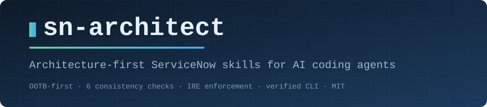
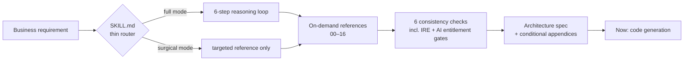

<div align="center">



[](LICENSE)
[](https://agentskills.io)
[](#how-it-works)
[](sn-architect/references/08-consistency-checks.md)
[](#test-evidence)

</div>

# sn-architect — architecture-first ServiceNow skills for AI coding agents

`sn-architect` is a skill that turns your AI coding agent (Claude Code, Cursor, Antigravity, and other agent runtimes) into a ServiceNow **enterprise architect**. Instead of generating tables, business rules, and scripts on demand, the agent first designs the solution — evaluates what the platform already provides, models the schema, places logic, wires security, and validates the design against 6 mandatory consistency checks — **before** any code or configuration is generated.



---

## The problem it solves

If you have asked an AI agent to "build a ServiceNow app for loan requests," you have likely received:

- a custom table that duplicates `task` (losing SLAs, approvals, and unified fulfiller views),
- no ACLs at all — or worse, an **empty ACL** open to every authenticated user,
- `current.update()` inside a Before Business Rule (recursive loop),
- synchronous outbound REST calls freezing every user transaction,
- a custom approval table instead of the platform's approval engine,
- CLI commands that don't exist in the current ServiceNow SDK.

These are not model-knowledge problems — they are **workflow** problems. Agents generate code first and think about platform consequences never. This skill restructures that workflow.

## How it works

The skill is a **thin router, not a documentation dump**. `SKILL.md` (~100 lines) carries hard rules, a surgical-vs-full-mode decision, a 6-step reasoning loop, and a routing table. Seventeen modular reference files load **on demand**, only when a concern becomes active:

<details>
<summary><strong>All 17 reference files</strong> (click to expand)</summary>

| Reference | Concern |
|-----------|---------|
| `00-ootb-first.md` | Step 0 — never rebuild what the platform ships; OOTB evaluation protocol |
| `01-data-model.md` | Extend `task` vs standalone, naming standards, indexing, data lifecycle & scale |
| `02-logic-placement.md` | Before/After/Async BRs, Flow Designer, Script Includes, UI Actions, sync vs async |
| `03-ui-layer.md` | Configurable Workspace, UI Builder, Employee Center/Portal, Platform UI, mobile, Playbooks |
| `04-integration-design.md` | REST, IntegrationHub, Import Sets/RTE, MID Server, e-bonding, webhooks, identity |
| `05-security-design.md` | Explicit CRUD ACLs, ACL evaluation order, empty-ACL threat, instance hardening |
| `06-delivery-design.md` | ServiceNow SDK (Fluent) project layout, verified CLI, ATF, Git, upgrade management |
| `07-architecture-doc-template.md` | The specification template with conditional appendices (SLA, notifications, CMDB, AI) |
| `08-consistency-checks.md` | The 6-check validation gate (orphans, ACL completeness, transaction integrity, IRE enforcement, AI entitlement, ...) |
| `09-anti-patterns.md` | `getValue()` GlideElement trap, `current.update()` recursion, client GlideRecord, timezone bugs, ... |
| `10-requirements.md` | SLA / OLA / UC design |
| `11-notifications.md` | Notification records, event pipeline, inbound email |
| `12-knowledge.md` | Knowledge bases, article lifecycle, KCS |
| `13-ai-automation.md` | AI Agents, Now Assist/Otto, Virtual Agent, Predictive Intelligence, AI Search |
| `14-cmdb.md` | IRE enforcement, CSDM, data precedence, CMDB health |
| `15-approvals-assignment.md` | Approval engine, routing, assignment, on-call |
| `16-reporting-analytics.md` | Reports, database views, Performance Analytics |

</details>

Every reference follows the same discipline: **decision matrices instead of essays**, hard rules with falsification tests ("The test: ..."), and anti-pattern tables. Nothing is written from memory — factual claims (CLI commands, API signatures, table names) were verified against official ServiceNow documentation, and the skill itself carries the durable rule: *verify every CLI command against `now-sdk --help` before emitting it.*

## What you get

For a full application requirement, the agent produces an **architecture specification** before any code:

- OOTB evaluation with justification for every custom component
- Data model with relationships, naming, and indexing decisions
- Mermaid architecture diagram and sync/async execution mapping
- Security matrix: scoped roles, explicit CRUD + wildcard ACLs
- Conditional appendices exactly when relevant: SLA matrix, notification matrix, CMDB ingestion & IRE precedence table, AI agent tool & entitlement map
- Chronological phased build order and a risk register

For small tasks ("fix this ACL", "add one business rule"), the skill runs in **surgical mode** — it loads only the targeted reference and applies only the relevant check, instead of forcing the full ceremony.

---

## Installation

### Claude Code (personal — all projects)

```bash
git clone https://github.com/<you>/SERVICENOW-SKILLS.git
mkdir -p ~/.claude/skills
cp -r SERVICENOW-SKILLS/sn-architect ~/.claude/skills/sn-architect
```

Verify with `/skills` inside Claude Code, or by asking: *"Design a ServiceNow app for tracking building access passes"* — the agent should start with the OOTB evaluation, not with a `CREATE TABLE`.

### Claude Code (single project)

```bash
mkdir -p .claude/skills
cp -r /path/to/SERVICENOW-SKILLS/sn-architect .claude/skills/sn-architect
```

### Other agent runtimes (Codex, Gemini CLI, Copilot CLI)

These runtimes recognize the cross-runtime alias directory:

```bash
mkdir -p ~/.agents/skills
cp -r /path/to/SERVICENOW-SKILLS/sn-architect ~/.agents/skills/sn-architect
```

### Cursor / Antigravity / other tools

Copy the `sn-architect/` folder into the skills (or rules/prompts) directory your tool loads, following its own convention. The skill uses only the standard [agentskills.io](https://agentskills.io) format — `SKILL.md` with `name`/`description` frontmatter plus markdown references — so any runtime that supports the format can load it.

### Keeping it current

The skill self-guards against CLI drift, but the files themselves were verified against specific ServiceNow SDK and release documentation (see *Provenance*). Re-pull the repo after platform releases, or pin your copy and diff before upgrading.

---

## Usage

**Full architecture mode** — any request like:

- "Design a ServiceNow app to manage building access requests with manager approval"
- "We need to ingest asset data from our ERP — architect it"
- "Create a table model for vendor risk assessments with SLAs"

**Surgical mode** — single-component tasks:

- "Add an ACL so only fulfillers can close loan requests"
- "Write a Before BR that defaults the priority"
- "Why does my client script freeze the form?"

**Review mode** — point it at an existing design and ask it to run the consistency checks:

- "Review this architecture against your 6 checks"

## Provenance & accuracy

- CLI commands verified against the official ServiceNow SDK CLI reference (servicenow.github.io/sdk/cli) — `install`, not `deploy`; `download`/`transform`, not `fetch`; `cicd test`, not top-level `test`.
- AI/CMDB identifiers verified against official API documentation (`sn_aia_agent`, `sys_cb_topic`/`sys_cs_topic`, `sn_cmdb.IdentificationEngine`, ...).
- Security claims (`glide.sm.default_mode`, empty-ACL behavior, ACL evaluation order incl. `parent_table.*`) verified against ServiceNow security documentation.

## Test evidence

One full RED/GREEN comparison run (same model, same requirement, ~150-line output cap each): *"Build a ServiceNow app for temporary building access passes: employees request a pass, their manager approves, security issues it, and the pass expires."*

| Behavior | Without skill | With skill |
|----------|:---:|:---:|
| OOTB-first evaluation (task vs standalone, Store apps) | ✗ skipped | ✓ explicit, justified |
| Naming/indexing standards (plural labels, indexed refs) | ✗ partial | ✓ full |
| ACL package (CRUD + `table.*`, zero empty ACLs, RCA) | ~ partial | ✓ full |
| Approval timeout/escalation path | ✗ missing | ✓ timeout → escalate → auto-reject |
| Consistency checks run & reported | ✗ none | ✓ all 6, per-rule |
| Verified CLI (`now-sdk install`) | ✗ generic packaging | ✓ verified commands, ATF, Instance Scan |
| Invented APIs in code sample | ✗ 1 (`setWorkNotes`) | ✓ none |

**Honest caveats:** this is **n=1** — one scenario, one model, one run per arm. It is evidence the skill changes behavior in the targeted directions, not a benchmark. The test also surfaced a real gap: the skill-guided agent still wrote `u.manager + ''` (the GlideElement trap in concatenation form) — plugged in `09-anti-patterns.md` §1 and re-verified with a fresh micro-test (now emits `getValue()` in truthiness/comparison contexts). The baseline agent also beat the skill on one point (before-query business rules for row filtering), which was back-ported into `05-security-design.md`.

More scenarios welcome — [open an issue](../../issues) with the prompt and what went wrong if the skill routes wrong or misses a check.

## Contributing

The highest-value contributions are: (1) failing test scenarios — requirements where agents without the skill produce broken designs, (2) corrections with sources (docs links required — this project's standard is *no invented facts*), and (3) new reference files following the existing format: decision matrix → standards → anti-patterns → required output.

## License & disclaimer

MIT. This is an unofficial community project and is **not affiliated with, endorsed by, or sponsored by ServiceNow**. "ServiceNow" is a trademark of ServiceNow, Inc.; used here descriptively to indicate compatibility. Always validate generated architectures against your instance's release, licensing, and security posture — the skill is designed to tell the agent the same thing.