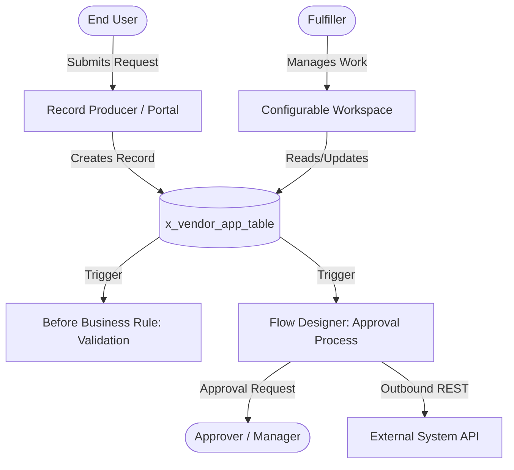

# Architecture Document Template (`07-architecture-doc-template.md`)

> The required specification template generated by `sn-architect` when presenting an end-to-end design.

---

```markdown
# Application Architecture Specification: [Application Name]

## 1. Executive Summary & Metadata
- **Application Name:** [Human-readable Name]
- **Scope Identifier:** `x_[vendor]_[app]`
- **Target Release:** [Platform Version / Release]
- **Primary Goal:** [1-2 sentence statement of business outcome]

---

## 2. Step 0: Out-of-the-Box (OOTB) Evaluation
- **Standard Tables Evaluated:** [e.g., task, interaction, sys_user]
- **Decision:** [e.g., Custom table extending task / Standalone table]
- **Justification for Custom Components:** [Explain why standard configuration was insufficient]

---

## 3. Persona & UI Experience Map
| Persona | Responsibilities | Target UI Layer | Entry Point |
|---------|------------------|-----------------|-------------|
| [End User] | Submits requests, tracks status | Employee Center / Portal | Record Producer |
| [Fulfiller] | Processes records, updates state | Configurable Workspace | Record Page / Workspace List |
| [Administrator] | Manages reference data & config | Platform UI | Studio / App Navigator |

---

## 4. Data Model & Relationships
### Tables
| Technical Table Name | Display Label | Extends | Purpose |
|----------------------|---------------|---------|---------|
| `x_[vendor]_[app]_[name]` | [Plural Label] | `task` or None | [Purpose] |

### Key Fields & Relationships
| Table | Field Name | Type | Reference Target | Mandatory? | Notes |
|-------|------------|------|------------------|:----------:|-------|
| `...` | `...` | Reference | `sys_user` | Yes | Indexed foreign key |
| `...` | `...` | Choice | — | Yes | Choices: New, Pending, Closed |

---

## 4A. Service Commitments — SLA Matrix *(conditional)*
> **Render only if** the design includes work items on `task`-extending tables. Otherwise omit this section entirely. Source standard: `references/10-requirements.md`.

| SLA Name | Type (SLA/OLA/UC) | Table | Target | Schedule / Timezone | Start | Pause (with unpause path) | Stop | Breach Action |
|----------|-------------------|-------|--------|---------------------|-------|---------------------------|------|---------------|
| [Name] | SLA | `x_[vendor]_[app]_[table]` | [duration / schedule-based] | [schedule + TZ decision] | [condition] | [pause ⇄ unpause pair] | [condition] | [notify / escalate] |

- **Timezone decision:** [whose clock runs the commitment — documented per `10-requirements.md` §2]
- **Volume impact:** [tasks/day × SLAs per task → `task_sla` growth → archiving decision]

---

## 5. System Architecture & Flow Diagram


---

## 6. Logic Placement & Execution Model
| Component Name | Type | Trigger / Timing | Execution Mode | Purpose |
|----------------|------|------------------|:--------------:|---------|
| `ValidateSubmission` | Business Rule | Before Insert | Synchronous | Validates required fields, calls `setAbortAction` |
| `LoanApprovalFlow` | Flow Designer | Record Created | Asynchronous | Multi-step approval and task generation |
| `LoanAppUtils` | Script Include | On Demand | Synchronous | Central class containing reusable business logic |

---

## 6A. Notification Matrix *(conditional)*
> **Render only if** the design includes notifications or messaging. Otherwise omit. Source standard: `references/11-notifications.md`.

| Notification Name | Trigger (Record condition / Event) | Recipients (dynamic / group / field) | Channel | Persona |
|-------------------|------------------------------------|--------------------------------------|---------|---------|
| [Name] | [condition / event `x_[vendor]_[app].[event]`] | [recipient source] | [Email / SMS / Push / Chat] | [persona] |

**Custom events register** (every event needs a producer AND a consumer — Check 1.3):

| Event Name | Producer (`gs.eventQueue` from) | Consumer (Notification / Script Action / Flow) |
|------------|--------------------------------|------------------------------------------------|
| `x_[vendor]_[app].[event_name]` | [component] | [consumer] |

---

## 6B. AI Agent Tool & Entitlement Map *(conditional)*
> **Render only if** the design specifies Now Assist / AI Agents / GenAI components. Otherwise omit. Source standard: `references/13-ai-automation.md`. **Enforced by Check 6, Rule 6.5 — no AI section ships without the entitlement verification completed.**

| Capability | Business Use | Entitlement & Release Verified? | Tools Bound / Inputs | Human-in-the-Loop Point | Success Metric |
|------------|--------------|--------------------------------|----------------------|-------------------------|----------------|
| [AI Agent / GenAI skill / VA / PI] | [use] | ☐ Instance: `[release ___ , entitlement ___]` | [tool set / training data] | [gated action] | [measurable target] |

- **Least-privilege tool audit:** every bound tool justified; no god-agents (see `13-ai-automation.md` §2).

---

## 7. Integration & Staging Architecture (If Applicable)
- **Method:** [e.g., Scripted REST API / IntegrationHub Spoke / Import Set + RTE]
- **Authentication:** [OAuth 2.0 / Mutual TLS / Credential Alias]
- **Idempotency Strategy:** [Correlation ID verification in headers]
- **Retry & Circuit Breaker Policy:** [Exponential backoff parameters]

---

## 7A. CMDB Ingestion & IRE Precedence Table *(conditional)*
> **Render only if** the design creates or updates Configuration Items. Otherwise omit. Source standard: `references/14-cmdb.md`. **Enforced by Check 6, Rule 6.4 — any CI write path that does not route through the IRE fails review.**

| Source | IRE Mechanism | Target Classes | Identification Criteria Available | Precedence Position |
|--------|---------------|----------------|-----------------------------------|---------------------|
| [Discovery / SGC / external push / custom app] | [`sn_cmdb.IdentificationEngine` / transform map IRE / REST API] | [classes via CI Class Manager] | [serial number, name+IP, ...] | [attribute precedence rank] |

- **Plugin verification:** ☐ `com.snc.cmdb.scoped` (required for scoped IRE API) verified on target instance.
- **Health gate:** [go-live CMDB health criteria per `14-cmdb.md` §5]

---

## 8. Security & Contextual Access Control (ACL) Matrix
*Default Deny Verification: Instance `glide.sm.default_mode` must be verified as `deny`.*

### Scoped Roles
- `x_[vendor]_[app]_admin`: Full configuration and delete privileges.
- `x_[vendor]_[app]_fulfiller`: Read, write, and state management.
- `x_[vendor]_[app]_user`: Read-only access to own submitted records.

### Mandatory CRUD ACLs
| Table | Operation | Role Required | Condition | Script |
|-------|-----------|---------------|-----------|--------|
| `x_[vendor]_[app]_[table]` | Read | `_user`, `_fulfiller` | `opened_by=javascript:gs.getUserID()` (for users) | — |
| `x_[vendor]_[app]_[table].*` | Read | `_user`, `_fulfiller` | — | — |
| `x_[vendor]_[app]_[table]` | Create | `_user` | — | — |
| `x_[vendor]_[app]_[table]` | Write | `_fulfiller` | `state!=closed` | — |
| `x_[vendor]_[app]_[table]` | Delete | `_admin` | — | — |

---

## 9. Phased Build Order
Strict chronological implementation sequence enforcing dependency integrity:

1. **Phase 1: Foundation & Security**
   - Create Scoped Application & Git repository linkage.
   - Define custom roles (`_admin`, `_fulfiller`, `_user`).
   - Create system properties (`sys_properties`) for dynamic configuration.
2. **Phase 2: Schema & Dictionary**
   - Create custom tables with singular technical names and plural labels.
   - Define columns, choices, and index foreign key reference fields.
   - Create table-level and field wildcard (`.*`) ACLs.
3. **Phase 3: Core Logic & Services**
   - Implement core Script Include class library.
   - Create Before Business Rules for data hygiene and validation.
   - Create After Business Rules or Event triggers.
4. **Phase 4: Workflows & Integrations**
   - Build Flow Designer flows, subflows, and approval triggers.
   - Configure REST messages / IntegrationHub spokes and credential aliases.
5. **Phase 5: User Interface & Experience**
   - Configure Workspace views, form sections, and related lists.
   - Build Record Producers and catalog items in Employee Center.
6. **Phase 6: Automated Testing & Verification**
   - Author ATF test suites covering security impersonation and business logic.
   - Execute Instance Scan rules and verify zero findings.

---

## 10. Consistency Check Results
- [x] **Check 1 (Orphans):** PASS — All components mapped to triggers and callers.
- [x] **Check 2 (Security):** PASS — Explicit CRUD ACLs defined; no empty ACLs; RCA documented.
- [x] **Check 3 (Execution):** PASS — No `current.update()` in Before BRs; async operations properly isolated.
- [x] **Check 4 (Data Model):** PASS — Correct singular/plural naming; foreign keys indexed; `sys_user` unextended.
- [x] **Check 5 (Build Order):** PASS — Chronological dependency graph is fully linear.
- [x] **Check 6 (OOTB):** PASS — No duplication of native platform capabilities; CI writes route through IRE (Rule 6.4); AI components entitlement-verified (Rule 6.5).

---

## 11. Open Questions & Technical Risk Register
| # | Question / Unknown | Impact Area | Proposed Resolution / Action Item |
|---|---------------------|-------------|------------------------------------|
| 1 | [e.g., Anticipated record creation volume per day] | Data Model / Performance | Verify with business whether archiving rules are needed. |
| 2 | [e.g., External API rate limits] | Integration Architecture | Confirm provider rate limits to tune retry policies. |
```
